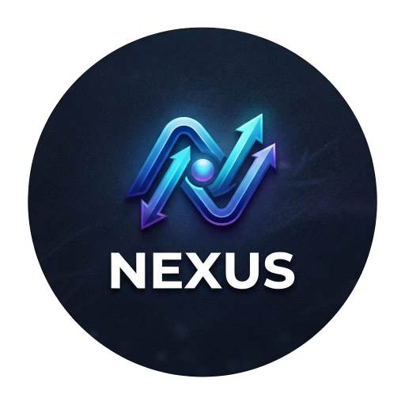

<p align="center">
  <picture>
    <source media="(prefers-color-scheme: dark)" srcset="./nexus_static/marketing/branding/logo-white.svg">
    
  </picture>
</p>

<p align="center">
  <a href="https://nexus.app/download">
    </a>
  <a href="https://docs.nexus.app">
    </a>
  <a href="https://nexus.app/donate">
    </a>
  <a href="./LICENSE">
    </a>
</p>

<p align="center">
  <a href="https://flathub.org/apps/app.nexus.NEXUS">
    </a>
</p>

# NEXUS

> [!IMPORTANT]
> Bug reports and feature requests have moved to [feedback.nexus.com](https://feedback.nexus.com). Sign in with your NEXUS account to post, vote and follow updates. GitHub Issues and Discussions are closed. Report security vulnerabilities privately through [nexus.app/security](https://nexus.app/security).

NEXUS is a free and open source instant messaging and VoIP chat app built for friends, groups, and communities.

<p align="center">
  
</p>

## Download

| Windows | macOS | Linux | Android | iOS |
| --- | --- | --- | --- | --- |
| [Installer (x64)][win-setup-x64] | [Disk image][mac-dmg] | [Flathub][flathub] | [Google Play (beta)][android-play] | [TestFlight][ios-testflight] |
| [Installer (ARM64)][win-setup-arm64] | | [deb (x64)][linux-deb-x64] | [APK (beta)][android-apk] | |
| [Portable (x64)][win-portable-x64] | | [deb (ARM64)][linux-deb-arm64] | [Obtainium (beta)][obtainium] | |
| [Portable (ARM64)][win-portable-arm64] | | [rpm (x64)][linux-rpm-x64] | | |
| | | [rpm (ARM64)][linux-rpm-arm64] | | |
| | | [AppImage (x64)][linux-appimage-x64] | | |
| | | [AppImage (ARM64)][linux-appimage-arm64] | | |
| | | [tar.gz (x64)][linux-targz-x64] | | |
| | | [tar.gz (ARM64)][linux-targz-arm64] | | |

The macOS disk image runs on both Apple silicon and Intel. Windows and Linux need the build matching your processor.

On Linux, prefer a repository over a single file so NEXUS updates with the rest of your system.

## Linux package repositories

The package is `nexus` for stable and `nexus-canary` for canary. apt and dnf subscribe to one channel per entry file. pacman and Flatpak serve both from one repository.

### Flatpak

Stable is on [Flathub][flathub], the easiest route on most desktops:

```sh
flatpak install flathub app.nexus.NEXUS
```

Flathub has stable only. To use NEXUS's own repository, open [the stable][flatpak-ref] or [the canary][flatpak-canary-ref] reference file and your software manager takes over. Some desktops also accept `flatpak+https://pkgs.nexus.com/flatpak/nexus.flatpakref` in the address bar.

From a terminal:

```sh
flatpak install https://pkgs.nexus.com/flatpak/nexus.flatpakref
```

### Debian and Ubuntu

```sh
sudo install -d -m 0755 /etc/apt/keyrings
sudo curl -fsSL -o /etc/apt/keyrings/nexus-archive-keyring.gpg https://pkgs.nexus.com/keys/nexus-archive-keyring.gpg
sudo curl -fsSL -o /etc/apt/sources.list.d/nexus.sources https://pkgs.nexus.com/deb/nexus.sources
sudo apt update && sudo apt install nexus
```

For canary, use the canary entry file and package.

```sh
sudo curl -fsSL -o /etc/apt/sources.list.d/nexus-canary.sources https://pkgs.nexus.com/deb/nexus-canary.sources
sudo apt update && sudo apt install nexus-canary
```

A `.deb` installed from a download only updates once its channel's entry is added.

### Fedora and RHEL

```sh
sudo curl -fsSL -o /etc/yum.repos.d/nexus.repo https://pkgs.nexus.com/rpm/nexus.repo
sudo dnf install nexus
```

For canary, use the canary entry file and package.

```sh
sudo curl -fsSL -o /etc/yum.repos.d/nexus-canary.repo https://pkgs.nexus.com/rpm/nexus-canary.repo
sudo dnf install nexus-canary
```

RHEL, Rocky, Alma and CentOS Stream need `sudo dnf install epel-release` first, because their base repositories lack `libXScrnSaver`. Fedora does not.

### Arch Linux

The repository is signed, so pacman needs the key once:

```sh
sudo pacman-key --init
curl -fsSL -o /tmp/nexus-archive-keyring.asc https://pkgs.nexus.com/keys/nexus-archive-keyring.asc
sudo pacman-key --add /tmp/nexus-archive-keyring.asc
sudo pacman-key --lsign-key 09D01339EE128925F75E675C855C5BDE34D205D2
```

`--lsign-key` is what makes pacman trust it. Then add the repository:

```sh
sudo tee -a /etc/pacman.conf >/dev/null <<'REPO'

[nexus]
SigLevel = Required TrustedOnly
Server = https://pkgs.nexus.com/arch/$repo/os/$arch
REPO
sudo pacman -Syu nexus
```

Write `$repo` and `$arch` literally. Both are pacman variables, not shell ones, hence the quoted heredoc.

Full setup notes, including canary, are in the [Linux repositories documentation][docs-linux].

## Other ways to run it

- [Open NEXUS in a browser](https://web.nexus.app), no install needed.
- [Host your own instance][docs-selfhost] from this repository.

## Documentation

- [Documentation home][docs]
- [Downloads][docs-downloads]
- [Self-hosting][docs-selfhost]

## License

The source is licensed under the [Nebula](./LICENSE) license.

NEXUS artwork, such as the logo, icons, badges and default avatars, is
licensed under [CC BY-SA 4.0](./nexus_static/LICENSE). Third-party material
keeps its own terms, listed in
[nexus_static/THIRD_PARTY_LICENSES.md](./nexus_static/THIRD_PARTY_LICENSES.md).

Use of the NEXUS name and logo is covered by the
[name and marks policy](./.github/GOVERNANCE.md#name-and-marks).

[win-setup-x64]: https://pkgs.nexus.com/desktop/stable/win32/x64/latest/setup
[win-setup-arm64]: https://pkgs.nexus.com/desktop/stable/win32/arm64/latest/setup
[win-portable-x64]: https://pkgs.nexus.com/desktop/stable/win32/x64/latest/portable
[win-portable-arm64]: https://pkgs.nexus.com/desktop/stable/win32/arm64/latest/portable
[mac-dmg]: https://pkgs.nexus.com/desktop/stable/darwin/arm64/latest/dmg
[linux-deb-x64]: https://pkgs.nexus.com/desktop/stable/linux/x64/latest/deb
[linux-deb-arm64]: https://pkgs.nexus.com/desktop/stable/linux/arm64/latest/deb
[linux-rpm-x64]: https://pkgs.nexus.com/desktop/stable/linux/x64/latest/rpm
[linux-rpm-arm64]: https://pkgs.nexus.com/desktop/stable/linux/arm64/latest/rpm
[linux-appimage-x64]: https://pkgs.nexus.com/desktop/stable/linux/x64/latest/appimage
[linux-appimage-arm64]: https://pkgs.nexus.com/desktop/stable/linux/arm64/latest/appimage
[linux-targz-x64]: https://pkgs.nexus.com/desktop/stable/linux/x64/latest/tar_gz
[linux-targz-arm64]: https://pkgs.nexus.com/desktop/stable/linux/arm64/latest/tar_gz
[flatpak-ref]: https://pkgs.nexus.com/flatpak/nexus.flatpakref
[flatpak-canary-ref]: https://pkgs.nexus.com/flatpak/nexus-canary.flatpakref
[flathub]: https://flathub.org/apps/app.nexus.NEXUS
[android-play]: https://play.google.com/store/apps/details?id=com.nexus
[android-apk]: https://github.com/nexusapp/flutter_client/releases
[obtainium]: https://obtainium.imranr.dev/
[ios-testflight]: https://testflight.apple.com/join/PKZR6pK9
[docs]: https://docs.nexus.app
[docs-downloads]: https://docs.nexus.app/downloads/overview/
[docs-linux]: https://docs.nexus.app/downloads/linux-repositories/
[docs-selfhost]: https://docs.nexus.app/operator/get-started/
